# Veri modeli (ERD)

```mermaid
erDiagram
    users ||--o{ tenant_user : "üyelik"
    tenants ||--o{ tenant_user : ""
    tenants ||--o{ branches : ""
    tenants ||--o{ services : ""
    tenants ||--o{ employees : ""
    tenants ||--o{ tenant_customers : "CRM (tenant'a özel)"
    tenants ||--o{ subscriptions : ""
    plans ||--o{ plan_features : ""
    plans ||--o{ subscriptions : ""
    subscriptions ||--o{ subscription_events : ""
    subscriptions ||--o{ subscription_invoices : ""
    subscriptions ||--o{ subscription_payments : ""
    branches ||--o{ branch_services : "fiyat/süre override"
    services ||--o{ branch_services : ""
    employees ||--o{ employee_branches : ""
    branches ||--o{ employee_branches : ""
    employees ||--o{ employee_services : "beceri + override"
    branches ||--o{ working_hours : "employee_id NULL = şube saatleri"
    employees ||--o{ employee_breaks : ""
    employees ||--o{ employee_leaves : ""
    branches ||--o{ blocked_times : ""
    appointments }o--|| branches : ""
    appointments }o--|| employees : ""
    appointments }o--|| tenant_customers : ""
    appointments ||--o{ appointment_services : "snapshot"
    appointments ||--o{ appointment_status_histories : ""
    appointments ||--o{ appointment_proposals : "en fazla 1 açık"
    appointments ||--o{ booking_holds : ""
    appointments ||--o{ appointment_payments : "salon içi kayıt"
    appointments ||--o{ guest_access_tokens : "hash"
    appointments ||--o{ action_tokens : "WhatsApp buton bağlamı"
    appointments ||--o| reviews : "UNIQUE(appointment_id)"
    reviews ||--o| review_replies : "UNIQUE(review_id)"
    reviews ||--o{ review_reports : ""
    reviews ||--o{ review_moderation_logs : ""
    branches ||--o| whatsapp_connections : "UNIQUE(branch_id)"
    whatsapp_connections ||--o{ whatsapp_messages : ""
    whatsapp_connections ||--o{ whatsapp_webhook_events : ""
    users ||--o{ customer_favorites : ""
```

## Önemli kısıtlar
| Kısıt | Amaç |
|---|---|
| `UNIQUE(tenant_id, id)` + bileşik FK'ler | Tenant tutarlılığı DB düzeyinde |
| `UNIQUE(tenant_id, phone_e164)` (tenant_customers) | Birleştirme politikası: tenant başına numara başına tek CRM kartı |
| `appointment_proposals.open_appointment_key` (stored generated) UNIQUE | Randevu başına tek açık teklif |
| `UNIQUE(tenant_id, resource_type, resource_id, local_date)` | Kilit satırı |
| `UNIQUE(tenant_id, idempotency_key)` (appointments) | Çift tıklama |
| `reviews.appointment_id` UNIQUE | Randevu başına tek yorum |
| `whatsapp_messages.provider_message_id`, `idempotency_key` UNIQUE | wamid tekrarı, gönderim dedupe |
| `whatsapp_webhook_events.provider_event_key` UNIQUE | Webhook tekrarı |
| `notification_deliveries.dedupe_key` UNIQUE | Bildirim tekrarı |
| `subscription_payments.idempotency_key`, `(provider, provider_event_id)` UNIQUE | Ödeme webhook tekrarı |
| CHECK: durum enumları, `rating BETWEEN 1 AND 5`, `ends > starts`, tutar ≥ 0, `discount ≤ subtotal` | MySQL 8.0.16+ zorunlu kılar |

Tüm tarih/saat sütunları UTC (`*_utc`); `working_hours.starts_local/ends_local` şube yerel duvar saatidir. Para `DECIMAL(12,2)`.

MySQL notu: Stored generated column'un taban sütununda `ON DELETE CASCADE` kullanılamadığından `appointment_proposals → appointments` FK'si `RESTRICT`'tir (randevular fiziksel silinmez).
